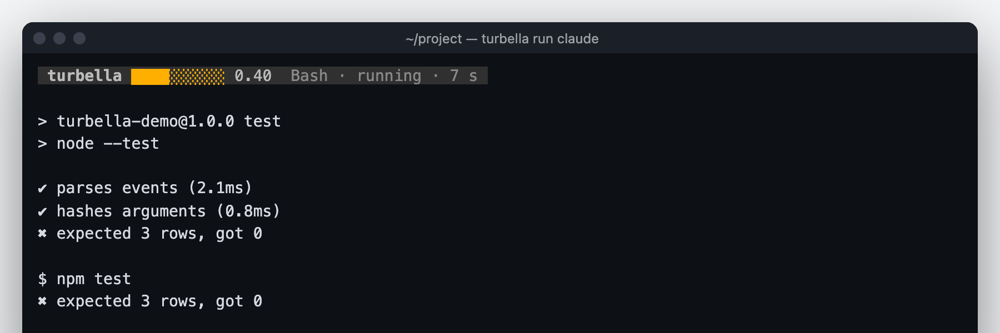

<h1 align="center">Turbella</h1>

<p align="center">
  <strong>See what your coding agent is doing while you wait:<br>
  every tool call, failure, retry and permission wait, live, with a gauge for when it is stuck.</strong>
</p>

<p align="center">
  A Claude Code plugin and a local page. macOS, Node 22. No account, no server, no telemetry. <a href="https://turbella.naklitechie.com">turbella.naklitechie.com</a>
</p>

<p align="center">
  
  
  <a href="LICENSE"></a>
  
</p>


## Install

| | |
|---|---|
| **Claude Code** | `claude plugin marketplace add NakliTechie/turbella`, then `claude plugin install turbella@turbella` |
| **From a clone** | `git clone https://github.com/NakliTechie/turbella`, then `claude --plugin-dir turbella` |
| **Copilot CLI** | `copilot plugin install NakliTechie/turbella` |
| **Cursor** | `turbella install cursor` adds Turbella's hooks to `~/.cursor/hooks.json`; restart Cursor |
| **Codex** | `codex plugin marketplace add <path to a clone>`, `codex plugin add turbella@turbella`, then trust its hooks with `/hooks` in Codex |
| **Hermes** | `turbella install hermes` prints a `hooks:` block for `~/.hermes/config.yaml`; approve the hooks when Hermes next starts |
| **opencode, pi, omp** | `turbella install opencode` (or `pi`, `omp`) writes a one-line plugin file into the agent's plugin folder; restart the agent |
| **The `turbella` command** | in the clone, `npm link` puts it on your PATH; or run `node bin/turbella` |

Start a session. The first hook starts the Turbella daemon and opens the visualiser at
`http://127.0.0.1:7377/viz` when no page is open (`TURBELLA_OPEN=0` turns that off), within
5 seconds of the first hook. No config file, no account. To replay a session, load a Claude
Code transcript from `~/.claude/projects/` with the timeline's **load** button.

## Why

You wait on an agent for minutes and learn nothing. Is it thinking, retrying the same
failing command, or blocked on a permission prompt? Turbella shows it while it happens.

Each session gets a lane. Each tool call is a tick, dark for edits and grey for the rest; a
failure is a red spike, and the same failure twice gets a repeat mark. A permission wait is
amber; a violet dot is thinking, larger for longer. The **turbulence gauge** (0 to 1) adds
four signals from the last five minutes: repeated failures, repeated edits to one file, the
same tool over and over, and time since the last successful call, which rises through a
silent wait because silence is part of being stuck. It borrows from "Fractal basins trap
latent reasoning" (arXiv:2609.04963): stuck reasoning keeps switching between near answers.

## Views

**The visualiser** (`/viz`) plays your agent like music. Every tool call is a pluck, a
failure is a bass hit, thinking is a slow swell and a permission wait is a held note; the
turbulence gauge adds noise and wobble as the agent gets stuck. Each new prompt blends to
another of about a hundred MilkDrop presets, run by [Butterchurn](https://github.com/jberg/butterchurn).
Nothing plays aloud. It needs WebGL 2; without it the page sends you to the timeline.

**The timeline** (`/`) is the plain record: what happened, when, and how often it repeated.

**Beside your agents** (macOS): `turbella overlay` opens a small always-on-top window per agent
session, and `turbella run <agent>` pins that agent's own gauge to the terminal's top row.




## What leaves your machine

Nothing. The hook hashes the tool's arguments, the edited file's path and any error text
with SHA-256, and sends the daemon only the hashes, the tool name and the status. File
contents, prompts, tool output and error text never leave the hook; thinking is read as
a duration only. A hash lets Turbella see that the same command failed the same way
three times without storing the command. The daemon listens on a Unix socket readable
only by you and on `127.0.0.1`, and answers only requests addressed to this machine.

## Other agents

Turbella hooks into Claude Code, Codex, Copilot CLI, Cursor, Hermes, opencode, pi and omp,
each on its own lanes. Codex reports no exit code for shell commands, so a failed Codex
shell command shows as a normal call. Any other app can send events and read the gauge;
[docs/PLUGINS.md](docs/PLUGINS.md) is the contract, with worked examples.

## Commands

```
turbella open                     # start the daemon if needed, open the visualiser
turbella overlay                  # always-on-top windows, one per agent session (macOS, swiftc)
turbella run claude               # any agent, with its own gauge strip on the terminal's top row
turbella status                   # events, counts by kind, the gauge, as JSON
turbella emit --kind tool_fail --tool Bash --payload '"exit 1"'   # send one event
turbella replay <file.jsonl>      # counts and gauge for a recorded transcript
turbella install opencode         # also cursor, pi, omp; claude, codex, copilot, hermes print steps
turbella start                    # run the daemon in the foreground
```

Every command is declared once in `src/manifest.js`; all but the person-only `install` and `run`
are served over MCP by `bin/turbella-mcp`, and the pages publish their controls to agents.

## Verify it yourself

```
npm run verify     # readers, gauge, playback, daemon, hook binary, CLI, MCP, manifest parity
npm run ttfv       # cold start: first hook to event on the page, gate 5 s (needs Chrome)
npm run strip      # the terminal strip against the same program unwrapped (needs tmux)
node marketing/capture.mjs   # regenerate the README images and social card from a scripted session
```

`npm run verify` runs the real hook binary against a daemon, checks that no file body, prompt,
output or error text leaves the hook, and fails if the CLI, MCP and page controls drift from the
manifest. `npm run ttfv` measured 167–367 ms on an Apple Silicon Mac. Live runs were checked by
hand (Claude Code, Codex, Copilot CLI, opencode; pi and omp turn and stop only); Cursor and Hermes were not.

## License

MIT — see [LICENSE](LICENSE). The bundled Butterchurn engine and presets are MIT too;
see [web/vendor/LICENSE](web/vendor/LICENSE).

For a coding agent or contributor: [AGENTS.md](AGENTS.md)
