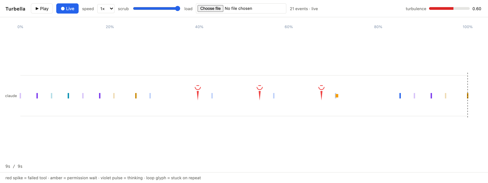

<h1 align="center">Turbella</h1>

<p align="center">
  <strong>See what your coding agent is doing while you wait:<br>
  every tool call, failure, retry and permission wait, live, with a gauge for when it is stuck.</strong>
</p>

<p align="center">
  A Claude Code plugin and a local page. macOS (Linux untested), Node 22. No account, no server, no telemetry.
</p>

<p align="center">
  
  
  
  
</p>



## Install

| | |
|---|---|
| **Claude Code** | `claude plugin marketplace add NakliTechie/turbella`, then `claude plugin install turbella@turbella` |
| **From a clone** | `git clone https://github.com/NakliTechie/turbella && claude --plugin-dir turbella` |

Start a Claude Code session. The first hook starts the Turbella daemon, and the session
opens with a line like `Turbella: http://127.0.0.1:7377`. Open that address, or run
`turbella open`, and leave the page in a corner of the screen. Events appear as the agent
works; the page shows the first one within 5 seconds of the first hook.

No config file, no account, nothing to start by hand. No session to watch? Run
`turbella open` and load any Claude Code transcript from `~/.claude/projects/` with the
page's **load** button to replay it.

## Why

You wait on an agent for minutes and learn nothing from the wait. Was it thinking,
retrying the same failing command, blocked on a permission prompt, or finished? The
transcript tells you afterwards. Turbella shows it while it happens.

Each tool call is a tick in the agent's lane, coloured by tool. A failure is a red spike,
and the same failure twice gets a repeat mark. A permission wait is amber. The
**turbulence gauge** (0 to 1) combines repeated identical failures, edit thrash on one
file, switching between tools, and time since the last real progress. It keeps rising
during a silent wait, because silence is part of being stuck.

The idea comes from "Fractal basins trap latent reasoning" (Gilpin's group,
arXiv:2609.04963): reasoning stuck near almost-correct answers keeps switching
candidates, and that switching rate measures how stuck it is. Turbella measures the
agent's observable version of that.

## What leaves your machine

Nothing. The daemon listens on a Unix socket and on `127.0.0.1` only. The hook passes it
the tool name, the arguments and any error text; the daemon keeps a SHA-256 hash of the
arguments or error and drops the text. A hash lets Turbella see that the same command
failed the same way three times without storing the command. Tool output, prompts,
notification text and thinking text never leave the hook.

## Other agents

Any agent or script can send an event with `turbella emit` (for example "switching
approach") or read the gauge with `turbella status`. Both start the daemon if it is not
running and never fail loudly, so an agent can call them mid-task.

## Commands

```
turbella open                     # start the daemon if needed, open the page
turbella status                   # events, counts by kind, the gauge, as JSON
turbella emit --kind tool_fail --tool Bash --payload '"exit 1"'   # send one event
turbella replay <file.jsonl>      # counts and gauge for a recorded transcript
turbella start                    # run the daemon in the foreground
```

Every command is declared once in `src/manifest.js`. The same tools are served over MCP
(`bin/turbella-mcp`, as `turbella_status`, `turbella_emit`, `turbella_replay`,
`turbella_open`). The page publishes its own controls (play, pause, speed, seek, load,
live) to agents as `navigator.modelContext` tools, or as `window.turbella.tools` where the
browser has no WebMCP.

## Verify it yourself

```
npm run verify     # readers, gauge, playback, daemon, hook binary, CLI, MCP, manifest parity
npm run ttfv       # cold start: first hook to event drawn on the page, gate 5 s
node marketing/capture.mjs   # regenerate the hero and social card from a scripted session
```

`npm run verify` runs the real hook binary against a daemon and fails if the CLI, the MCP
tool list or the page controls stop matching the manifest. `npm run ttfv` drives headless
Chrome and measured about 170 ms on an Apple Silicon Mac. Live delivery is verified end to
end in a headless Claude Code session. Codex, opencode and ACP adapters are not built yet;
`turbella emit` is the way in for those agents today.

## License

Not yet licensed: all rights reserved while the repository is private.

What is next and why: `plan/` · for a coding agent: `AGENTS.md`
